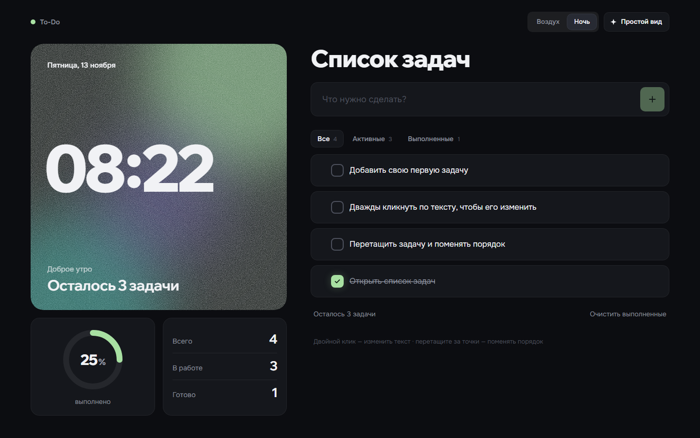
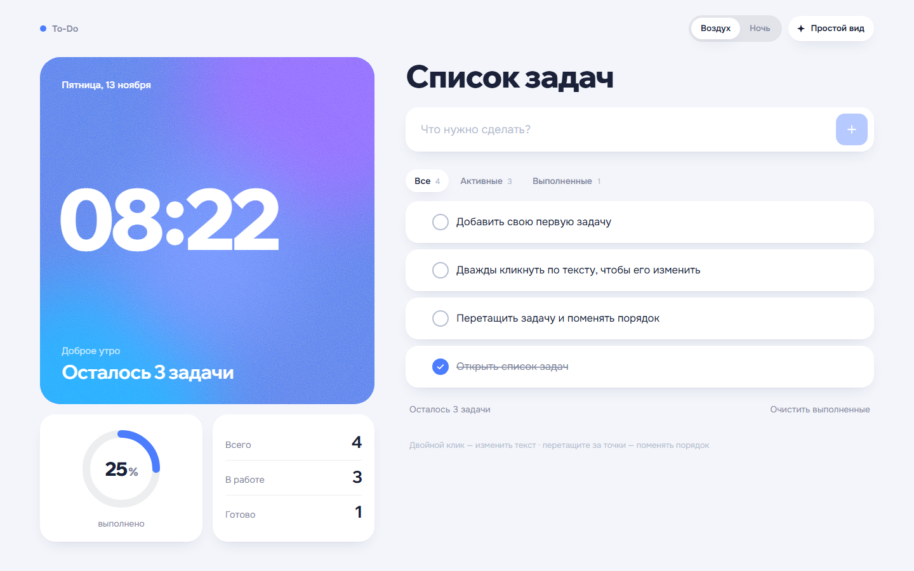
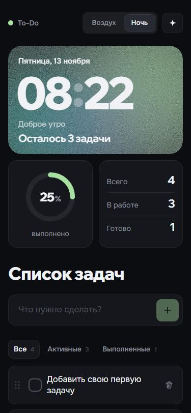
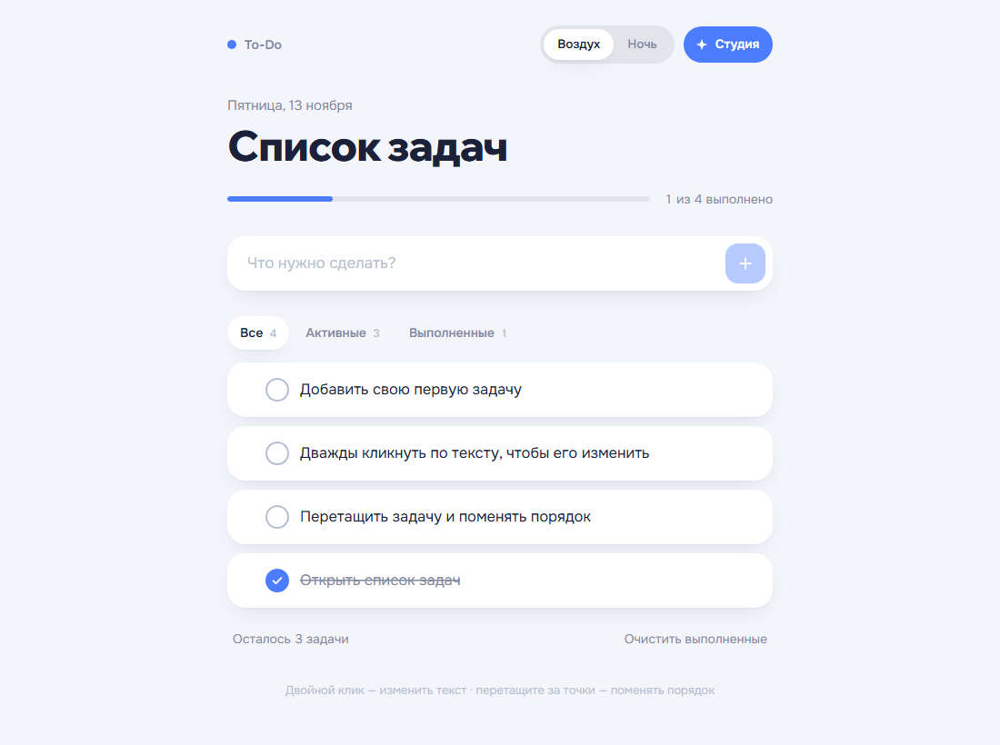

<div align="center">

# Список задач

To-Do List на React и TypeScript с двумя стилями оформления и развёрнутым видом «Студия».

**[Открыть сайт → todo-digital.pages.dev](https://todo-digital.pages.dev)**

</div>




## Задание

Сделать сайт «Список задач» с помощью AI-инструментов.

| Требование | Как сделано |
| --- | --- |
| Добавление задач | Поле вверху списка, Enter или кнопка «+». Пустые строки и лишние пробелы не принимаются |
| Отметка выполненных | Чекбокс с анимацией галочки, текст плавно зачёркивается |
| Удаление задач | Корзина у каждой задачи и «Очистить выполненные»; 5 секунд можно нажать «Вернуть» или Ctrl+Z |
| Сохранение после обновления | Список, выбранный стиль и вид хранятся в `localStorage` браузера |

## Что добавлено сверху

- **Редактирование** — двойной клик по тексту, на телефоне одно нажатие; Enter сохраняет, Esc отменяет.
- **Фильтры** «Все / Активные / Выполненные» со счётчиками.
- При добавлении из «Выполненных» список переключается на «Все», чтобы новая задача сразу была видна.
- **Перетаскивание** задач для смены порядка, с клавиатуры — стрелками вверх и вниз.
- **Два стиля**: «Ночь» (тёмный) и «Воздух» (светлый). Новый стиль раскрывается кругом от кнопки.
- **Вид «Студия»**: карточка дня с живыми часами, кольцо прогресса, счётчики и салют, когда закрыта последняя задача. Кнопкой переключается на компактный «Простой вид».
- Набранный текст новой задачи сохраняется при переключении между видами.
- **Экран загрузки** и поочерёдное появление блоков.
- **Синхронизация вкладок** — изменения в одной вкладке сразу видны в другой.
- **Адаптив** от 320 пикселей до широких мониторов.
- **Мобильная панель**: логотип и переключатели закреплены сверху при прокрутке в обоих видах. На десктопе панель остаётся обычной.
- **Доступность**: задачи можно редактировать кнопкой, клавишами Enter и пробел, в том числе с внешней клавиатуры на планшете. У кнопок есть подписи для экранных дикторов, учитывается системная настройка «Уменьшить движение».

<table>
  <tr>
    <td width="68%"></td>
    <td></td>
  </tr>
  <tr>
    <td align="center">«Студия», стиль «Воздух»</td>
    <td align="center">Телефон</td>
  </tr>
</table>



## Стек

- **React 19** и **TypeScript** в строгом режиме
- **Vite** — сборка и дев-сервер
- **Motion** — анимации: перетаскивание, появление и удаление задач, счётчики
- **CSS** без фреймворков: оформление построено на CSS-переменных, оба стиля — это два набора значений одних и тех же токенов
- **View Transitions API** — круговая смена стиля и вида
- Шрифты **Wix Madefor Display** (заголовки) и **Onest** (текст) подключены локально, без запросов к Google Fonts
- **Cloudflare Pages** — хостинг

Бэкенда нет: данные живут в браузере пользователя.

## Как это работает

### Хранение

Задачи сохраняются в `localStorage` под ключом `the-digital-todo:v1` при каждом изменении. При чтении отбрасываются записи с неверными типами, пустым ID или текстом, текстом длиннее 200 символов и некорректной датой. При повторении ID сохраняется первая корректная запись.

Если хранилище недоступно (например, приватный режим в некоторых браузерах или переполнение), список продолжает работать и показывает предупреждение о невозможности сохранения. После успешной записи предупреждение исчезает.

При первом открытии в списке лежат четыре задачи-подсказки, которые показывают возможности.

### Дата и время

Часы и дата берутся с устройства пользователя (`new Date()`) и форматируются через `Intl.DateTimeFormat('ru-RU')`. Поэтому человек в любом часовом поясе видит своё время и свою дату. Обновление идёт раз в секунду, и таймер живёт только в карточке дня и в строке даты: раз в секунду перерисовываются они, а не весь список. Если вкладка открыта через полночь, дата сменится сама.

Приветствие зависит от часа: до 5 — «Доброй ночи», до 12 — «Доброе утро», до 18 — «Добрый день», дальше — «Добрый вечер».

### «Вернуть»

При удалении запоминаются удалённые задачи и их позиции. «Вернуть» ставит их на прежние места и не откатывает то, что пользователь успел сделать после удаления: отметки и новые задачи остаются.

## Запуск

Для разработки используйте Node.js **22.22.2** — эта версия закреплена в `.node-version` и используется в CI и Cloudflare. Поддерживаемые версии перечислены в `engines.node` файла `package.json` с учётом инструментов сборки и тестов.

```bash
npm ci
npm run dev
```

Сайт откроется на http://localhost:5173.

```bash
npm run build      # проверка типов и сборка в dist/
npm run preview    # просмотр собранной версии
npm run deploy     # сборка и выкладка на Cloudflare Pages
```

## Проверки

```bash
npm run check      # линтер, типы, автотесты и сборка
npm run lint       # Oxlint: ошибки кода, React Hooks и доступность
npm run typecheck  # проверка типов исходников, тестов и конфигурации
npm test           # Vitest + Testing Library в jsdom
npm run test:watch # тесты при изменении файлов
```

Тесты проверяют повреждённое хранилище и ошибки сохранения, операции с задачами, отмену удаления, порядок при фильтрации, синхронизацию вкладок, сохранность черновика при смене вида и редактирование с клавиатуры.

GitHub Actions запускает `npm run check` при push в `main` и при создании или обновлении pull request. Тесты работают с изолированным хранилищем jsdom и не затрагивают задачи в браузере пользователя.

## Публикация

Cloudflare Pages собирает репозиторий `peals-pline/todo-studio` из ветки `main`.
Команда сборки — `npm run build`, каталог результата — `dist`.
Версия Node.js зафиксирована в `.node-version`. После push в `main` Cloudflare запускает новую сборку автоматически.

Для ручной публикации через `npm run deploy` нужна авторизация Cloudflare Wrangler.

## Структура

```
src/
├── App.tsx              разметка страницы, оба вида
├── components/          интерфейс: задача, поле ввода, фильтры, карточка дня, кольцо…
├── hooks/
│   ├── useTodos.ts      список задач: добавить, отметить, изменить, удалить, вернуть
│   ├── useTheme.ts      стиль «Ночь» / «Воздух»
│   ├── useLayout.ts     вид «Студия» / «Простой»
│   └── useNow.ts        текущее время для часов и даты
├── lib/                 хранилище, склонения, формат даты, экран загрузки
└── styles/
    ├── tokens.css       цвета, радиусы, тени для каждого стиля
    ├── app.css          базовые стили и простой вид
    └── studio.css       вид «Студия»
```
